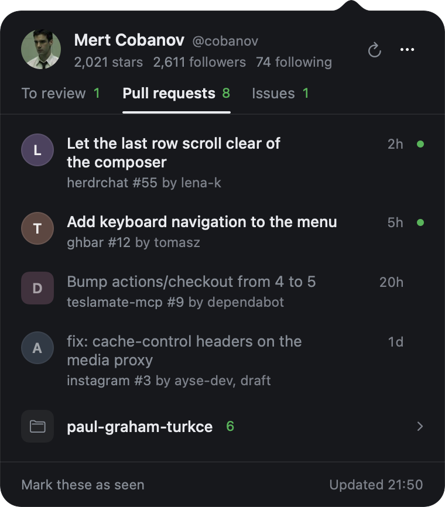

<p align="center">
  
</p>

<h1 align="center">GHBar</h1>

<p align="center">
  Pull requests and issues people open on your GitHub repositories, in the macOS menu bar.
</p>

<p align="center">
  <a href="https://github.com/cobanov/ghbar/releases/latest"></a>
  
  
</p>

<p align="center">
  
</p>

## Install

```sh
curl -fsSL https://ghbar.cobanov.dev/install.sh | sh
```

Or with Homebrew:

```sh
brew install --cask cobanov/tap/ghbar
```

Or download `GHBar-macos.zip` from the [latest release](https://github.com/cobanov/ghbar/releases/latest)
and move GHBar to Applications.

Needs macOS 14 or newer. The app is signed and notarized by Apple.

## Use

Open GHBar and sign in with GitHub. If the [GitHub CLI](https://cli.github.com) is signed in,
you can continue as that account instead.

Click the icon in the menu bar. The panel shows pull requests waiting for your review, pull
requests and issues other people opened on your repositories, and your own open pull requests.
Green marks what you haven't seen yet.

| Key | |
| --- | --- |
| ↑ ↓, Return | Move between rows, open one on GitHub |
| ← → | Switch tabs |
| ⌘R | Refresh |
| ⌘, | Settings: organizations, hidden repositories, notifications, launch at login |

GHBar talks only to GitHub, with your own token, kept in the macOS Keychain. It has no server
and no analytics.

## Update or remove

Run the install command again to update, or `brew upgrade --cask ghbar`.
To remove GHBar, quit it and move it to the Trash, or run `brew uninstall --cask ghbar`.

## Build from source

```sh
git clone https://github.com/cobanov/ghbar && cd ghbar
make install
```

## License

MIT. GHBar is an independent project, not affiliated with GitHub, Inc.
